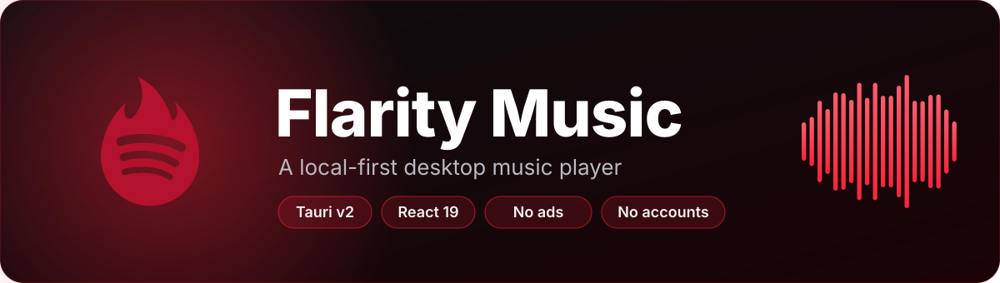

<div align="center">



**Your local music library, played natively on your desktop. Lyrics translated into any language.**

[](https://github.com/PhoPhuc/flarity-music/releases/latest)
[](https://github.com/PhoPhuc/flarity-music/releases)
[](https://github.com/PhoPhuc/flarity-music/stargazers)
[](LICENSE)
[](https://tauri.app)
[](https://react.dev)
[](https://www.rust-lang.org)

[**Download**](https://github.com/PhoPhuc/flarity-music/releases/latest) ·
[**Features**](#features) ·
[**Quick start**](#quick-start) ·
[**Privacy**](#privacy) ·
[**Contributing**](#contributing)

</div>

---

## Why Flarity

- **Your files, your library.** Flarity plays the music you already own. There are no accounts, no ads, and no analytics SDK. Listening stats live in a local SQLite database on your machine.
- **Native, not Electron.** The shell is written in Rust with Tauri v2 and uses the WebView already on your system, so the app stays small and starts quickly.
- **Lyrics in your language.** Translate synced lyrics with free Google Translate, or bring your own key for Gemini, Claude, OpenAI, OpenRouter, or any OpenAI-compatible endpoint such as Ollama or LM Studio.

---

## Features

### Library and playback

- Scan a music folder for **MP3, FLAC, WAV, M4A, AAC and OGG** files.
- Synced **`.lrc` lyrics** are picked up automatically when they share a filename with the track, and so are matching music videos.
- Lyrics lookup through [LRCLIB](https://lrclib.net), with lyric search and batch lyric tools.
- Full-screen lyric mode, a queue, and global keyboard shortcuts.
- Edit track metadata in-app.
- Smart recommendations based on what you listen to.

### AI lyrics translation

Translation runs on the provider you choose. Requests go straight from the app to that provider.

| Provider | Key required | Notes |
|---|:---:|---|
| Google Translate | No | Free, works out of the box |
| Google Gemini | Yes | Default model: `gemini-3.5-flash-lite` |
| Anthropic Claude | Yes | Claude models |
| OpenAI | Yes | GPT-4o family |
| OpenRouter | Yes | One key for many models |
| Custom endpoint | Optional | Any OpenAI-compatible API, including Ollama and LM Studio |

Translations appear as a subtitle under each lyric line in one of four styles: **Apple Music**, **Spotify**, **Cinema**, or **Neon**. Translation is manual by default. Turn on auto-translate in Settings if you prefer it on open.

### Visuals

- Six background styles that move with the music: Fluid Mesh, Starfield, Aurora, Vinyl, Spectrum, and an OLED Black mode.
- A music video player with Picture-in-Picture support.

### YouTube (optional)

- Search and stream YouTube Music tracks without an account.
- Download tracks with tags and cover art. This needs [`yt-dlp`](https://github.com/yt-dlp/yt-dlp) installed on your system. [`ffmpeg`](https://ffmpeg.org) is optional.

### Stats and sharing

- Top tracks and top artists ranked by listening time.
- Export your charts as shareable images.

---

## Download

Grab the latest Windows build from the [**Releases page**](https://github.com/PhoPhuc/flarity-music/releases/latest):

- **Setup installer** (`-x64-setup.exe`), per-user install
- **MSI installer** (`-x64.msi`)
- **Portable ZIP** (`-portable-x64.zip`), extract and run

macOS builds are not attached to releases yet. To run on macOS, [build from source](#quick-start).

---

## Quick start

### Requirements

| | Windows | macOS |
|---|---|---|
| Node.js | 20.19+ or 22.12+ | 20.19+ or 22.12+ |
| Rust | Stable, 1.77.2+ | Stable, 1.77.2+ |
| Other | WebView2 (built into Windows 11) | Xcode Command Line Tools |
| Optional | `yt-dlp`, `ffmpeg` | `yt-dlp`, `ffmpeg` |

### Build from source

```bash
git clone https://github.com/PhoPhuc/flarity-music.git
cd flarity-music
npm install

npm run dev           # run the desktop app in development mode
npm run dist          # Windows: installer and portable build
npm run build:macos   # macOS: universal build (Apple Silicon and Intel)
```

On first launch, choose the folder that contains your music.

---

## Privacy

Flarity is local-first. Here is exactly what leaves your machine:

- **Nothing to Flarity.** The app has no server of its own, no accounts, and no analytics.
- **Listening history stays local.** Play counts and stats are stored in a SQLite database on your computer.
- **Only when you use a feature:**
  - Lyrics lookup: `lrclib.net`
  - Translation: the provider you select (Google, Gemini, OpenAI, Anthropic, OpenRouter, or your custom endpoint)
  - YouTube search and discovery: YouTube, noembed.com, and the iTunes Search API
  - Update checks: the GitHub Releases API

---

## Tech stack

| Layer | Technology |
|---|---|
| Desktop shell | Tauri v2 (Rust), system WebView |
| Backend | Rust, SQLite (`rusqlite`), `yt-dlp` integration |
| Frontend | React 19, TypeScript, Vite 8, Tailwind CSS 4 |
| State and data | TanStack Query and Virtual, React Context |
| Icons | lucide-react |

---

## Project structure

```
flarity-music/
├── src/                    # React 19 + TypeScript frontend
│   ├── components/         # Player, library, lyrics, settings, analytics
│   ├── context/            # PlayerContext: global playback state
│   ├── hooks/              # Shortcuts, telemetry, updater, recommendations
│   ├── services/           # Lyrics translation providers, update checks
│   └── utils/              # Audio helpers, LRC parser, LRCLIB client, Tauri bridge
├── src-tauri/              # Rust backend (Tauri v2)
│   ├── src/                # Commands, database, covers, telemetry, security
│   ├── tauri.conf.json
│   └── Cargo.toml
├── scripts/                # Build and packaging helpers
├── docs/assets/            # README banner and social preview
└── public/                 # Static assets and logo
```

---

## Contributing

Issues and pull requests are welcome.

1. For larger changes, open an issue first so we can agree on the approach.
2. Create a branch, make your change, and run `npm run build` (type check and production build) before you push.
3. Open a pull request that describes what changed and why.

Bug reports are most useful with your OS, the Flarity version number, and the steps to reproduce.

---

## Acknowledgements

- [Tauri](https://tauri.app) for the native shell
- [LRCLIB](https://lrclib.net) for open lyrics data
- [yt-dlp](https://github.com/yt-dlp/yt-dlp) for YouTube downloads
- **[Antigravity](https://deepmind.google/technologies/gemini/)** (Google DeepMind), AI pair programmer

---

## License

Flarity Music is released under the [MIT License](LICENSE).

<div align="center">

Made by **[PhoPhuc](https://github.com/PhoPhuc)**. If Flarity is useful to you, a star helps others find it.

</div>
